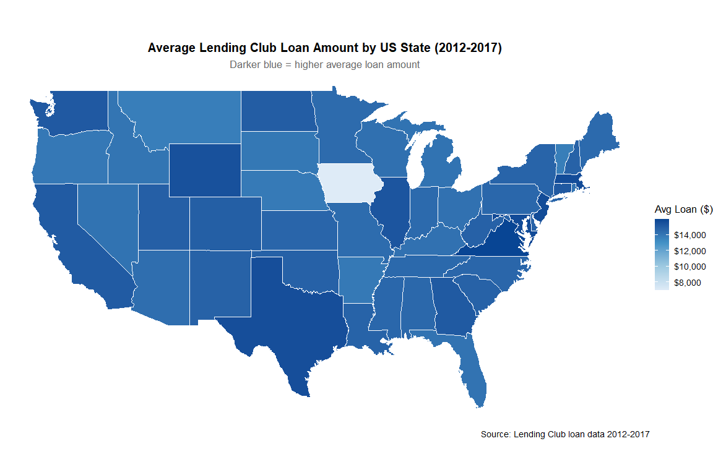

# Lending Club: six years of lending patterns

An independent Data Science Tools final analysis by Arman Khachatryan at New England College.
The project combines 2012–2017 loan files with state and region lookups, cleans types,
and explores loan grades, interest rates, borrower income, employment and geography.

## What the code demonstrates

- Stacking six annual files under an explicit schema and validating joins.
- Data cleaning and grouped summaries using R and the tidyverse.
- Grade/rate and borrower/loan visual comparisons using ggplot2.
- US choropleth maps and regional comparisons with documented lookup data.

## Interpretation and limits

The figures are existing outputs from the final course analysis; no new loan-level
computation was performed during portfolio packaging. Patterns in these observational
loans describe the supplied sample, not causal effects, underwriting advice or future
credit performance. Geographic totals can reflect market size and coverage. No new
model-accuracy or financial-impact claim is attached to this descriptive work.

## Explore and reproduce

`analysis.Rmd` retains the report and commented R source; `analysis.R` exposes its
code chunks. See `data/README.md` and `ENVIRONMENT.md`. The package excludes raw loans,
borrower records, assignment briefs and personal paths. The public adaptation was
syntax-checked but the historical loan analysis was not rerun during packaging.
