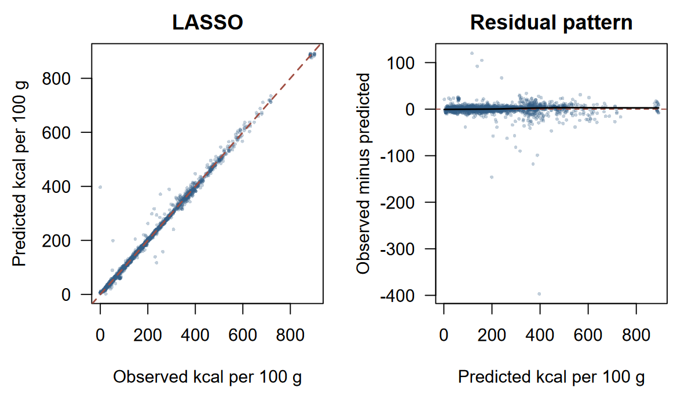

# Nutrition prediction with regularization

An independent coursework analysis by Arman Khachatryan at New England College.
I compared LASSO, Ridge and Elastic Net to predict calorie density (`Energ_Kcal`,
kcal per 100 g), choosing the penalty by cross-validation before evaluating the test set.

## Approach

The supplied export has 8,789 foods, 42 fields, 33 numeric nutrient predictors and
25 food groups. A food-group-stratified split reserves 7,022 development and 1,767
test foods. Five identical folds compare 1,111 alpha/lambda settings. Each fitting
fold learns its own medians and missingness indicators; IDs, names and portion
weights are excluded. The final design has 88 columns, including food-group terms.

## Saved results

| Technique | Held-out RMSE (kcal/100 g) | MAE | R-squared |
|---|---:|---:|---:|
| Constant development mean | 169.561 | 135.373 | -0.0004 |
| LASSO | 14.466 | 5.981 | 0.9927 |
| Ridge | 14.400 | 6.001 | 0.9928 |
| Elastic Net | 14.471 | 5.982 | 0.9927 |

Cross-validation selected LASSO (alpha 1, lambda 0.05248; CV RMSE 11.955).
Its held-out RMSE is 14.47 kcal/100 g. Ridge's slightly lower test error is reported
without changing the predeclared selection after viewing the test set. The three
techniques are effectively very close; the tiny differences do not establish a
meaningful algorithm advantage. Selected LASSO retains 63 of the 88 design columns.

## Interpretation and limits

This is food-composition prediction, not a nutrition recommendation. Coefficients
are conditional associations, not causal effects. Similar food formulations may
appear in both partitions, so the test does not demonstrate transfer to new product
families. Total carbohydrate is absent from this export. The largest absolute test
error is 396.90 kcal/100 g; a high aggregate R-squared does not remove individual errors.
Predictor sets differ from the earlier GAM exercise, preventing an algorithm-only comparison.

## Explore and reproduce

Read `analysis.Rmd`, inspect aggregate CSVs in `results/`, and see `ENVIRONMENT.md`
and `data/README.md` for rerunning. The original saved execution record is included.
The public adaptation was syntax-checked; models were not refitted during packaging.
Raw food records, row-level predictions, fitted models, course prompts and local
library paths are excluded.
