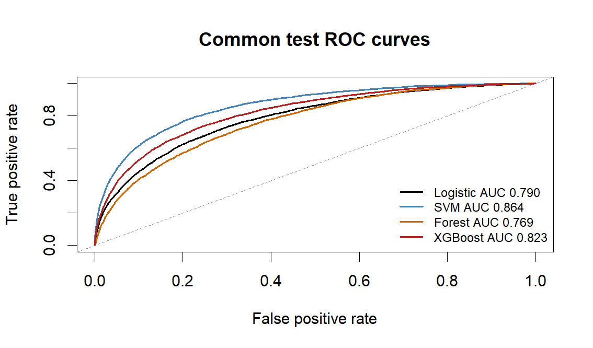

# Santander classification: comparing probabilities fairly

An independent coursework analysis by Arman Khachatryan at New England College.
I compared logistic regression, a radial SVM, Random Forest and XGBoost on identical
fitting and evaluation rows instead of ranking scores produced on different samples.

## Question and approach

Can the four previously selected model specifications beat a constant probability
forecast when each receives the same 6,000-customer training budget? The source
contains 200,000 labeled customers and 200 anonymized features. A stratified split
reserves 39,999 rows each for validation and test. Training-only medians and scaling
avoid preprocessing leakage. The SVM is calibrated on validation scores; held-out
log loss is the shared probability-quality measure.

## Saved results

| Model | Test log loss | ROC AUC | Accuracy at 0.50 | Recall at 0.50 |
|---|---:|---:|---:|---:|
| Logistic regression | 0.27372 | 0.78956 | 90.37% | 17.79% |
| Calibrated SVM | 0.23037 | 0.86378 | 91.36% | 26.97% |
| Random Forest | 0.28586 | 0.76930 | 89.95% | 0.00% |
| XGBoost | 0.34360 | 0.82338 | 90.54% | 8.31% |

The SVM reduced test log loss by 29.36% against the constant-probability baseline
(0.32613). An always-negative classifier already achieves 89.95% accuracy, so the
headline accuracy alone hides weak positive-class recall. XGBoost's extremely low
training loss and worse-than-baseline test loss show overconfidence at this small
training budget; this does not establish that boosting is generally inferior.

## Interpretation and limits

- Results compare four frozen specifications under a shared resource budget.
- Earlier course experiments informed those choices. This is internal validation,
  not a fresh external test or evidence of deployment performance.
- Only the SVM is recalibrated. Its validation loss is a calibration-fit diagnostic.
- Feature names are anonymized: `var_81` cannot be translated into a customer trait.
- No business error costs were supplied; probability loss is not dollars saved.

## Explore and reproduce

`analysis.Rmd` contains the report and full commented R code; `analysis.R` exposes
the executable chunks. Aggregate outputs live in `results/`. See `ENVIRONMENT.md`
and `data/README.md` before rerunning. Raw data, row-level predictions, model objects,
course prompts, grades and personal machine paths are excluded. The copied saved
results were inspected during packaging; the models were not refitted.
